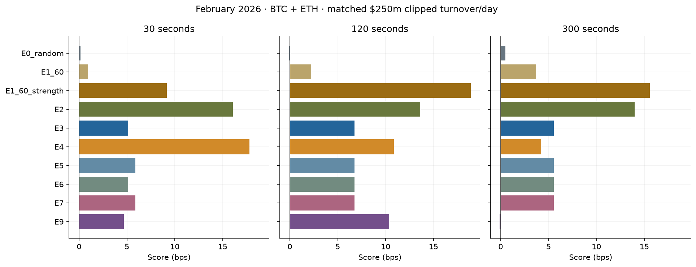

# Liquidation-Based Maker Trade Filtering

[](https://github.com/Flidison/liquidation-maker-filtering/actions/workflows/checks.yml)

**Can liquidation and market-state information improve hypothetical maker trade selection?**

This project studies liquidation activity in BTCUSDT and ETHUSDT perpetual futures, predicts liquidation bursts,
and compares rules, Ridge, LightGBM and CatBoost as filters on Binance trade prints. The final outcome is the
change in clipped-notional-weighted maker markout after filtering. Burst prediction is an intermediate task.

The evidence is mixed. A simple flow-ranked rule has strong retrospective point scores, but added burst
probabilities and observable A–S risk features do not show a confirmed incremental benefit. February was
repeatedly inspected during research; no independent hidden test has been performed.

## Dataset

The supplied dataset contains **1,315,384,304 records over 90 UTC days**, December 1, 2025–February 28, 2026:

| Feed | BTCUSDT records | ETHUSDT records |
|---|---:|---:|
| Binance trades | 401,902,513 | 705,880,385 |
| Binance BBO/bookticker | 99,169,477 | 107,797,036 |
| Binance liquidations | 114,255 | 131,769 |
| Bybit liquidations | 228,655 | 160,214 |

The feeds came with the research assignment. Their collection vendor, original download terms and redistribution
permission are not documented. **No original market-data rows or fitted model weights are published.** The repository
includes artificial schema-compatible fixtures, aggregate research results, configurations and working implementations.
The full Parquet sources and trained models remain in the original local workspace.

The full-row audit found no missing cells or invalid basic price/amount values. It did find exact duplicate trades,
long BBO gaps, and 63 BTC / 46 ETH Bybit timestamp reversals in physical file order. These observations are handled
explicitly; repeated trade rows are not automatically discarded as bad executions. See [data schemas and access](data/README.md)
and the [rights/source review](docs/rights_and_sources.md).

## Research methodology

For a trade at time `t`, price `p`, taker sign `s ∈ {−1,+1}`, and horizon `h ∈ {30,120,300}` seconds:

```text
maker_markout_bps = -s * (mid_asof(t+h) - p) / p * 10_000 + 0.5
weight           = min(price * amount, 100_000)
PnL_all          = sum(weight * markout) / sum(weight)
PnL_kept         = sum(kept_weight * markout) / sum(kept_weight)
Score            = PnL_kept - PnL_all
```

`mid_asof(t+h)` is the last BBO midpoint at or before the target time; an equal-time quote is allowed.
Trades whose targets fall outside global BBO bounds are excluded. The +0.5 bps term is the assigned rebate.
`PnL_filtered` is reported separately. USDT notionals are treated as USD. The binary interface is **0 keep / 1 filter**.

The official constraint is at least **$500,000 average daily kept clipped turnover**. Main model comparisons match
**$250 million/day total across BTC and ETH**, with at most one clipped trade of rounding over the whole period.
This is different from $250 million per symbol or a minimum for each individual day.

Maker training uses December–January; February is validation. The effective regression sample starts December 22
after warmup. Regression fits require `second + 301 < boundary`. Weekly expanding Logistic Regression fits use a
10-second purge and chronological out-of-fold probabilities. Model fitting uses a deterministic group sample;
official evaluation uses **all eligible raw trades**, aggregated losslessly when decisions coincide.

Market-state features use messages strictly before the integer-second boundary and are held for that second.
Liquidation alignment also uses the exact trade timestamp with `[t-window, t)` boundaries. Bybit events become
available after a fixed 200 ms delay, applied once. Future quotes used as labels do not enter features.
The older DC classification study uses a separate 60/15/15-day split; it must not be confused with the maker split.

## Features, models and losses

Feature groups include BBO spread/imbalance and staleness, lagged returns and realized volatility, trade counts
and signed flow, liquidation counts/notional/ages/intensity ratios, predicted burst probabilities, and six
observable volatility/spread risk proxies inspired by Avellaneda–Stoikov. They do not identify own inventory or
an execution-intensity model.

| Experiment | Prediction or decision |
|---|---|
| E0 / E0_random | Keep all / deterministic random budget control |
| E1 / E1_60 | Initial 5s / corrected 60s aligned signed-liquidation-flow rule |
| E1_60_strength | 60s aligned rule, ranked by prior-boundary absolute net liquidation notional; default `signal` |
| E2 | StandardScaler + Ridge, alpha 100; predicts maker markout |
| E3 | Fixed LightGBMRegressor: 32 trees, 15 leaves, depth 5, learning rate 0.05 |
| E4 | E3 without liquidation features and alignment |
| E5 / E6 / E7 | E3 + OOF burst probabilities / A–S proxies / both |
| E8 | Not implemented: inventory and execution quantities are not identified |
| E9 | CatBoostRegressor on the exact E3 sample and 81 features; 32 trees, depth 4, learning rate 0.05 |

Logistic Regression and LightGBMClassifier predict **liquidation bursts**, not maker markout. The historical
DC/Markov/W–L classifier and the newer side-specific Logistic Regression stacking model are separate experiments.
Their Brier score, average precision, precision and recall are retained in notebook 03.

Ridge and maker LightGBM use **weighted squared error**; Ridge also has its L2 penalty. CatBoost uses **weighted
RMSE**. Group weights are summed clipped notionals, adjusted for sampling and normalized to mean one during fitting.
Classification uses **binary log loss**. The official economic Score is evaluated separately and is not a training loss.
Full-trade MSE includes the within-group residual variance; it is not the logged grouped training RMSE.

E2/E3 are the project's fixed-architecture reconstructions. Historical reference fitted weights were unavailable;
these results do not reproduce the exact earlier V4 implementation. No authorship of the reference baseline methods
is claimed. [Methodological details and differences](docs/methodology.md).

## Main findings

February validation, combined BTC + ETH, matched $250m/day clipped turnover; **Score in bps**:

| Strategy | 30s | 120s | 300s |
|---|---:|---:|---:|
| E0_random | 0.161330 | −0.081000 | 0.497358 |
| E1_60 | 0.934747 | 2.239850 | 3.708019 |
| E1_60_strength | 9.162323 | 18.893918 | 15.585496 |
| E2 Ridge | 16.078705 | 13.616301 | 13.991484 |
| E3 LightGBM | 5.148496 | 6.735727 | 5.531530 |
| E4 no liquidations | 17.811140 | 10.861847 | 4.211977 |
| E5 + LR | 5.876502 | 6.735727 | 5.531530 |
| E6 + A–S proxies | 5.148496 | 6.735727 | 5.531530 |
| E7 hybrid | 5.876502 | 6.735727 | 5.531530 |
| E9 CatBoost | 4.691114 | 10.377586 | −0.096945 |



- **E3 versus E4:** removing liquidation features improves the 30s/120s point Score and worsens 300s.
  The expanded 5-day paired intervals include zero. Almost all E3 split gain is assigned to liquidation features,
  but feature importance does not establish economic value or causality.
- **Logistic additions:** E5−E3 is +0.728006 bps at 30s, with an adjusted interval including zero; predictions
  are unchanged at 120s/300s. The combined buy-side burst Brier score is slightly worse than a train-prior constant,
  while sell-side Brier improves. Classification improvement does not by itself validate a maker benefit.
- **A–S risk features:** zero split gain in these fixed regressors; E6 equals E3 and E7 equals E5.
  This is a negative result for this feature/model setup, not a general test of inventory-aware market making.
- **CatBoost versus LightGBM:** E9 improves the 120s point Score, but loses at 30s and 300s.
  All three multiplicity-adjusted paired 5-day intervals include zero.
- **MSE versus Score:** at 120s E9 weighted MSE is 734.133387 bps² versus E3's 737.599802 bps²;
  at 300s they are nearly identical (1550.627586 versus 1550.603199), despite very different tail-filter Scores.
  Global regression accuracy and economic selection quality are separate questions.
- **Robustness:** daily concentration and fixed-threshold transfer materially affect the comparison.
  January-frozen E9 thresholds retain approximately $132.5m / $99.3m / $31.3m per day in February at 30/120/300s,
  rather than the nominal $250m. Confidence intervals do not undo repeated selection on February.

Sources: [full comparison](artifacts/results/catboost/v1/comparison_report.csv),
[paired ablations](artifacts/results/maker/expanded_paired_comparisons.csv),
[E9 paired intervals](artifacts/results/catboost/v1/paired_e9_e3.csv),
[regression errors](artifacts/results/catboost/v1/regression_error_diagnostics.csv),
[threshold transfer](artifacts/results/catboost/v1/threshold_transfer_report.csv).
The default rule is a retrospective selection and does not dominate every strategy at every horizon.

## Reproducibility

Use **Python 3.11**. On macOS, LightGBM may also require the OpenMP runtime (`brew install libomp`).

```bash
git clone https://github.com/Flidison/liquidation-maker-filtering.git
cd liquidation-maker-filtering
python3.11 -m venv .venv
source .venv/bin/activate
pip install -r requirements.txt
pip install --no-deps -e .
python -m pytest -q
python scripts/verify_publication.py
python scripts/execute_notebooks.py
```

Run notebooks in order:

1. [Data Exploration & Quality](notebooks/01_data_exploration.ipynb)
2. [Liquidation Activity & Features](notebooks/02_liquidation_features.ipynb)
3. [Liquidation Prediction](notebooks/03_liquidation_prediction.ipynb)
4. [Maker Strategies](notebooks/04_maker_strategies.ipynb)
5. [CatBoost Research](notebooks/05_catboost_research.ipynb)
6. [Strategy Evaluation & Robustness](notebooks/06_evaluation_robustness.ipynb)

All six contain executed outputs and can be rerun with the released aggregate tables and synthetic fixtures.
They rebuild the presentation and independently reconcile selected scores; this is **not a full raw-data refit**.
There are 117 passing portable checks at publication. Another 47 cases require original data, caches or fitted models
and are explicitly excluded from the default test run. CI executes the portable suite and all six notebooks.

```python
from pathlib import Path
import pandas as pd
from submission import signal

sample = Path('data/sample')
filters = signal(
    pd.read_csv(sample / 'binance_trades/perp_btcusdt.csv'),
    pd.read_csv(sample / 'binance_booktickers/perp_btcusdt.csv'),
    pd.read_csv(sample / 'binance_liquidations/perp_btcusdt.csv'),
    pd.read_csv(sample / 'bybit_liquidations/btcusdt.csv'),
)
# {30: uint8 array, 120: uint8 array, 300: uint8 array}; original row order
```

The default rule is operational without learned weights. `hybrid_signal` exposes E7 and
`catboost_submission.catboost_signal` exposes E9, but learned-model execution requires locally restored weights.
Missing-model keep-all output is an engineering fallback, not a reproduced ML strategy. Chunked calls require
at least 1,205 seconds of liquidation context and 61 seconds of trades/BBO context.

[Full rebuild and model restoration](docs/reproducibility.md) requires authorized original data and substantial local
storage/compute. It is kept separate from the small notebook replay; no full refit was run for this publication.

## Repository

```text
notebooks/                 six executed research notebooks
src/maker_hybrid/          original maker features, models, evaluation and inference
src/liquidation_*.py       bursts, follow-through, DC warning and statistical checks
src/evt_log_cond*.py       logistic/LightGBM classification and reduced-model study
src/data_quality_audit.py  original full-row audit extracted from notebook functions
artifacts/results/         frozen aggregate tables and exact experiment configurations
artifacts/figures/         figures rebuilt from those tables
configs/                  publication scope, source/code audits
data/sample/               independently generated artificial feeds
tests/                    portable checks and explicit full-data integration checks
scripts/                  notebook execution, publication verification, rebuild helpers
submission.py             selected E1_60_strength inference entry point
```

## Limitations

- **February is repeatedly inspected validation, not an independent hidden test.** Bootstrap intervals and
  multiplicity adjustments do not remove this selection bias.
- Historical maker markout is **not realized trading profit**. The experiment assumes hypothetical participation
  in retained prints and does not model queue position, own fills, inventory, cancellations or execution latency.
- Results depend on retained turnover, threshold calibration and a small number of active days.
  A fixed threshold cannot guarantee future turnover.
- Bursts/cascades are provisional observational labels; episode ends are retrospective, with window/offset and
  cleaning sensitivity. Long BBO gaps can make forward-filled future labels stale.
- E2/E3 and the 60s rule do not reconstruct unavailable historical reference weights or exact reference cleaning.
- Original data and learned weights remain local. Aggregate replay is reproducible publicly;
  the complete historical fit/evaluation cannot be regenerated from this repository alone.

## Research status

“Completed” below refers to implemented research with saved outputs and historical validation evidence;
it is not a claim that the full dataset was rerun during publication.

| Workstream | Status and evidence |
|---|---|
| Data quality analysis | Completed; eight-source audit, counts, integrity and reconciliation tables |
| Liquidation feature engineering | Completed; detector configs, thresholds, sensitivity, causal feature code |
| Maker markout labels | Completed; original implementation, boundary/side/rebate tests, full-stream sufficient statistics |
| Ridge / LightGBM maker research | Completed; fixed specs, E2–E7 results, daily aggregates |
| Logistic Regression / DC warning research | Completed; split definitions, metrics and probability diagnostics |
| CatBoost research | Completed; E9 sample/spec receipts, exact MSE, paired comparisons |
| Controlled ablations | Completed for E3–E7 and E9; several additions show no confirmed improvement |
| Retrospective robustness evaluation | Completed; bootstrap, day/block sensitivity, daily stability and threshold transfer |
| Public notebook/result replay | Completed; six notebooks executed; portable tests run locally and in CI |
| Full refit in a fresh public clone | Not performed; requires original data and compute; rebuild sequence supplied |
| Full dataset / fitted-weight distribution | Withheld; original redistribution permission is unresolved |
| Independent hidden test | Not yet performed |
| Full execution-aware market-making simulation | Not implemented |

The [publication audit](docs/publication_audit.md) records what was retained, omitted, checked and changed.
Project-authored code is under [MIT](LICENSE); this does not license third-party market data or methods.
